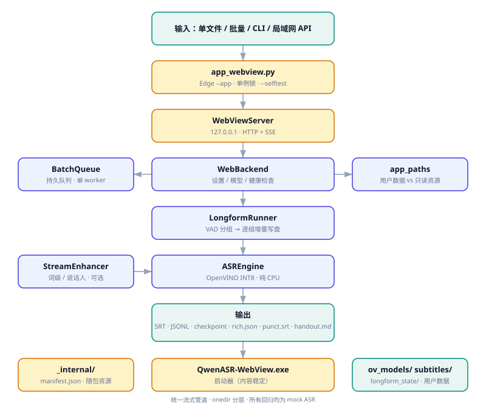

# 文档索引

简体中文 · [繁體中文](README.zh-Hant.md)

本页只列文档，不写代码，也不放开发计划。想找实现细节请看源码；想找排期请看本地笔记（不进仓库）。

## 按目的找

| 我想… | 看 |
|---|---|
| 知道这项目能干嘛、有什么限制 | [README](../README.md) 顶部「先说边界」 |
| 理解整体结构（窗口、打包、路径、SSE） | [架构说明](架构说明.md) |
| 理解长音频为什么这样切、断点怎么保证 | [长音频流式方案](长音频流式方案.md) |
| 打包 / 更新 / 回滚 / SmartScreen | [打包与升级](打包与升级.md) |
| 逐项确认哪些功能支持、哪些是遗留 | [功能矩阵](功能矩阵.md) |
| 判断「验证过没有」 | [验证边界](验证边界.md) |
| 离线下载模型需要哪些文件 | [模型下载清单](模型下载清单.md)（生成物，不翻译） |
| 知道模型能吃多长音频、有哪些硬约束、值不值得重导 | [模型输入约束](模型输入约束.md) |
| 参与贡献、遵守文档与注释约定 | [风格规范](风格规范.md) |
| 新增 / 修改界面文案、理解三语 i18n 契约 | [多语文案契约](多语文案契约.md) |
| 看版本历史 / 第三方许可 | [CHANGELOG](../CHANGELOG.md) · [NOTICE](../NOTICE) |
| 看明暗双主题架构图 | [architecture.svg](architecture.svg) · [architecture-dark.svg](architecture-dark.svg) · [源](architecture.mmd) |

## 语言约定

- 面向用户的文档**简繁两个独立文件**，每页顶部互链，能去能回。
- 生成物（`models.json`、下载清单、manifest）与许可原文**不翻译**，只留一份。
- `docs/长音频流式方案.md` 与 `docs/legacy/README_upstream.md` 是历史原文，按原样保留。
- 代码注释 / docstring / 测试 / workflow 注释用英文；UI 维持三语 i18n。

## 边界前置

所有文档遵循同一条写法：**先写限制与未验证项，再写功能**。
性能宣称必须附实测数字，没有就写「未实测」。详见 [风格规范](风格规范.md)。

## 架构图

<picture>
  <source media="(prefers-color-scheme: dark)" srcset="architecture-dark.svg">
  
</picture>

[Mermaid 源](architecture.mmd) 可 diff、可改；SVG 是明暗双主题的静态产物。
