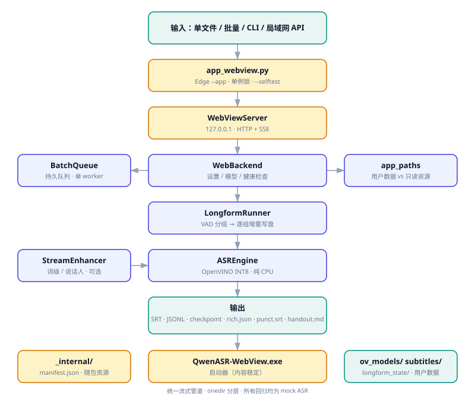

# 文件索引

繁體中文 · [简体中文](README.md)

本頁只列文件，不寫程式碼，也不放開發計畫。想找實作細節請看原始碼；想找排期請看本地筆記（不進倉庫）。

## 按目的找

| 我想… | 看 |
|---|---|
| 知道這專案能幹嘛、有什麼限制 | [README](../README.zh-Hant.md) 頂部「先講邊界」 |
| 理解整體結構（視窗、打包、路徑、SSE） | [架構說明](架構說明.zh-Hant.md) |
| 理解長音訊為什麼這樣切、中斷點怎麼保證 | [長音訊串流方案](长音频流式方案.md) |
| 打包 / 更新 / 回滾 / SmartScreen | [打包與升級](打包與升級.zh-Hant.md) |
| 逐項確認哪些功能支援、哪些是遺留 | [功能矩陣](功能矩陣.zh-Hant.md) |
| 判斷「驗證過沒有」 | [驗證邊界](驗證邊界.zh-Hant.md) |
| 離線下載模型需要哪些檔案 | [模型下載清單](模型下载清单.md)（產物，不翻譯） |
| 知道模型能吃多長音訊、有哪些硬約束、值不值得重匯 | [模型輸入約束](模型輸入約束.zh-Hant.md) |
| 參與貢獻、遵守文件與註解約定 | [風格規範](風格規範.zh-Hant.md) |
| 新增／修改介面文案、理解三語 i18n 契約 | [多語文案契約](多語文案契約.zh-Hant.md) |
| 看版本歷史 / 第三方授權 | [CHANGELOG](../CHANGELOG.md) · [NOTICE](../NOTICE) |
| 看明暗雙主題架構圖 | [architecture.svg](architecture.svg) · [architecture-dark.svg](architecture-dark.svg) · [原始檔](architecture.mmd) |

## 語言約定

- 面向使用者的文件**簡繁兩個獨立檔案**，每頁頂部互鏈，能去能回。
- 產物（`models.json`、下載清單、manifest）與授權原文**不翻譯**，只留一份。
- `docs/长音频流式方案.md` 與 `docs/legacy/README_upstream.md` 是歷史原文，按原樣保留。
- 程式註解 / docstring / 測試 / workflow 註解用英文；UI 維持三語 i18n。

## 邊界前置

所有文件遵循同一條寫法：**先寫限制與未驗證項，再寫功能**。
效能宣稱必須附實測數字，沒有就寫「未實測」。詳見 [風格規範](風格規範.zh-Hant.md)。

## 架构图

<picture>
  <source media="(prefers-color-scheme: dark)" srcset="architecture-dark.svg">
  
</picture>

[Mermaid 源](architecture.mmd) 可 diff、可改；SVG 是明暗双主题的静态产物。
